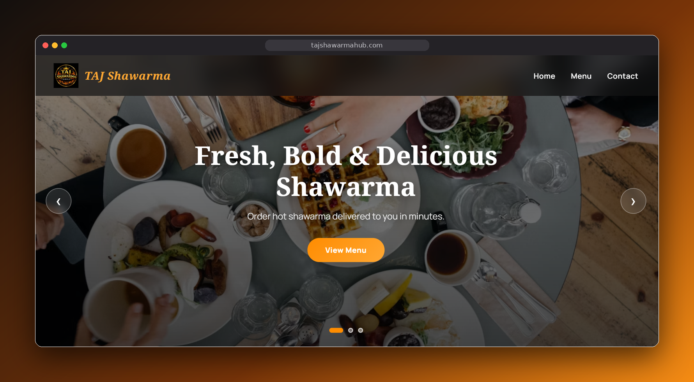

# TAJ Shawarma

<p align="center">
  <a href="https://tajshawarmahub.com">
    
  </a>
</p>

Website for TAJ Shawarma, a shawarma and grill spot in Abeokuta, Nigeria.

**Live site:** [tajshawarmahub.com](https://tajshawarmahub.com)

## Features

- Full menu (shawarma, toast, grilled and crispy chicken, wraps, quesadillas, noodles, breakfast, drinks)
- Cart with multiple packs, so one order can be split into separate packs
- Checkout that sends the finished order to the restaurant on WhatsApp
- Simple admin page for editing menu items and prices

## Tech

Plain HTML, CSS and JavaScript. No framework and no build step. Icons come from Font Awesome via CDN.

| File | Purpose |
| --- | --- |
| `index.html`, `script.js`, `styles.css` | Home page, menu and cart |
| `checkout.html`, `checkout.js` | Order summary and WhatsApp handoff |
| `Admin.html`, `Admin.js`, `Admin.css` | Menu editor |
| `_redirects` | Netlify routes for `/checkout` and `/admin` |

## Running locally

Open the folder with any static server, for example VS Code Live Server or:

```bash
npx serve .
```

Use the `.html` URLs locally (`/checkout.html`, `/Admin.html`). The extensionless routes only work on Netlify, because they come from `_redirects`.

## Deployment

Hosted on Netlify. The repo root is the site root, so it can be deployed by dragging the folder into Netlify's deploy page.

## Admin panel limitations

The admin page is a client-side demo. Its password check runs in the browser, and menu edits are saved to that browser's `localStorage` only, so other visitors never see them. A rebuild with a real backend and proper authentication is planned.

## License

Copyright © 2026 TAJ Shawarma. All rights reserved. The code is public for viewing, but the TAJ Shawarma name, logo and images may not be reused.
